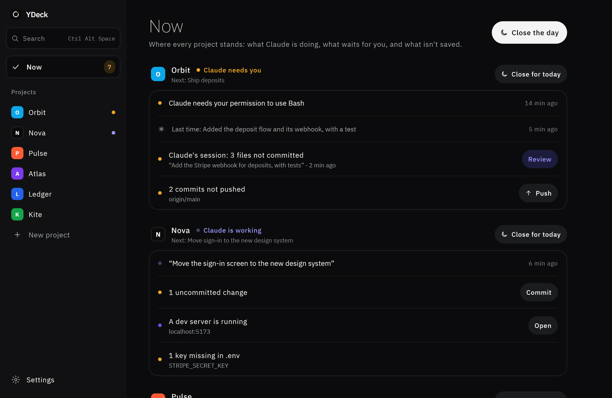
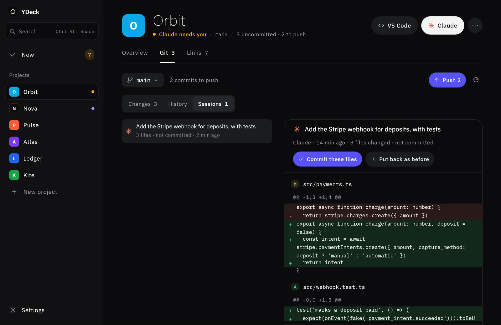

# YDeck

**Nothing left open.** Every project on one screen, for developers who run Claude Code in several projects at once.

YDeck is a free, open-source Windows app that shows where every project stands: what Claude Code did, where it's
waiting for you, and what isn't saved yet. No more going window to window to find the terminal that asked "Do you want
to proceed?" twenty minutes ago.

**[Download for Windows](https://github.com/yonidev0101/YDeck/releases/latest)** · [Website](https://ydeck-app.pages.dev) · [עברית](https://ydeck-app.pages.dev/he/)



## What it does

- **Now.** One screen, the project that needs you first: Claude waiting for an answer (and the question), Claude at
  work (and on what), then whatever is left open: uncommitted changes, commits not pushed, a branch not on the server,
  a dev server still running, a key missing from `.env`. Each one with the button that closes it.
- **Receipts.** Every Claude Code session leaves a receipt: the prompt, the files it changed, the diff. Commit exactly
  those files, or put them back as they were.
- **Memory.** What was done last time and the next step, kept per project in `.ydeck.local.json` (personal, out of git)
  and `.ydeck.json` (summary, decisions, links, releases; shared with the repo). Claude Code reads them at the start of
  every session, so it picks up where you left off.
- **Close the day.** One click per project: Claude commits, pushes, stops what runs and writes where it stands and the
  next step. Then Now says it: nothing open.
- **Where you already are.** A strip at the bottom of File Explorer when a project's folder is open, desktop widgets
  (one project, or all of them), a tray icon, `Ctrl+Alt+Space` search, and Windows notifications when Claude needs you.
- **Fill in with Claude.** Connect a folder and Claude (its quick model, read-only, never your `.env` files) suggests
  what the project is, a summary, a next step, its links and its commands. You edit and pick what to keep.



## How it knows

YDeck installs a small Claude Code plugin, `ydeck`, with one click (and removes it on uninstall). Its hooks tell YDeck
when a session starts, waits for you, and stops, over `127.0.0.1` with a per-install key. Nothing leaves your computer.
Git state comes from `git` itself, run in each project folder; dev servers and `.env` keys are read locally.

## Requirements

- Windows 10 or 11
- [Claude Code](https://docs.anthropic.com/en/docs/claude-code) for the agent parts (YDeck still tracks git without it)
- Git

## Install

Download the MSI from [Releases](https://github.com/yonidev0101/YDeck/releases/latest) and run it. The installer is
built by GitHub Actions from the tagged commit, but isn't code-signed yet, so SmartScreen asks once: **More info → Run
anyway**. Uninstalling (Windows Settings → Apps, or Settings → About in YDeck) takes back everything YDeck added: the
Claude Code plugin, "Open in YDeck" on Explorer's menu, the folder icons, starting with Windows. Your code and your
projects' `.ydeck` files stay as they are.

## Privacy

No account, no analytics, no server. Your projects and settings live in `%APPDATA%\YDeck`. The optional Android
companion syncs through an end-to-end encrypted relay (AES-256-GCM; the key exists only in the QR code the phone scans).
Details: <https://ydeck-app.pages.dev/privacy>.

## Building from source

JDK 21 (Android Studio's bundled one works).

```bash
./gradlew :desktop:run           # run it
./gradlew :desktop:test          # tests
./gradlew :desktop:distribute    # dist/YDeck-Windows-<version>.msi
```

| Folder | What it is |
|---|---|
| `desktop/` | The Windows app: Kotlin, Compose Desktop, packaged as an MSI with jpackage + WiX. |
| `app/` | The Android companion: Kotlin, Jetpack Compose and Glance widgets. |
| `shared/` | Code and assets both apps use. |
| `relay/` | The phone ↔ computer relay: a Cloudflare Worker with a Durable Object per pair. |
| `site/` | The website (Cloudflare Pages). |
| `store/` | Brand, films, store listing. |

Releases: bump `desktopVersion` in `desktop/build.gradle.kts`, commit, and push a matching tag (`v1.18.3`); the
[workflow](.github/workflows/windows.yml) builds the MSI and publishes it.

## Code signing policy

Every installer is built by GitHub Actions from a tagged commit in this repository and published only on
[Releases](https://github.com/yonidev0101/YDeck/releases). Committer, reviewer and approver:
[Yoni (yonidev0101)](https://github.com/yonidev0101). The full policy: <https://ydeck-app.pages.dev/code-signing>.

## License

[MIT](LICENSE). The YDeck name and logo identify this project; please don't use them for a fork in a way that suggests
it is YDeck itself.
